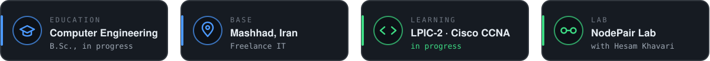
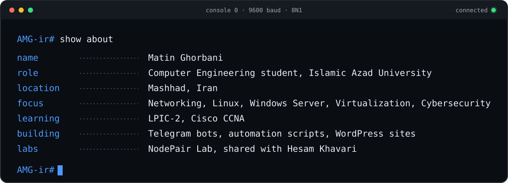
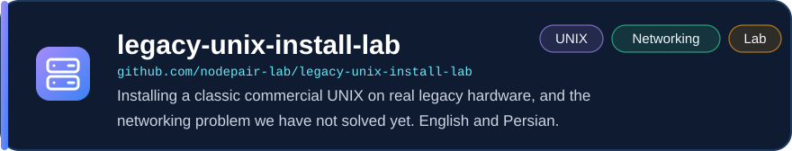
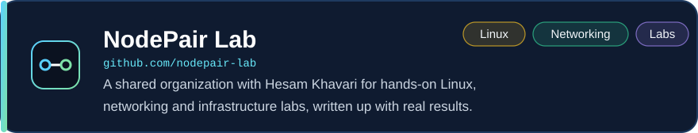

<picture>
  <source media="(prefers-color-scheme: light)" srcset="assets/banner-light.svg">
  
</picture>

 

<picture>
  <source media="(prefers-color-scheme: light)" srcset="assets/stats-light.svg">
  
</picture>

<picture>
  <source media="(prefers-color-scheme: light)" srcset="assets/divider-light.svg">
  
</picture>

## About

I'm a Computer Engineering student building my skills in **networking, Linux and Windows administration, virtualization, and cybersecurity** through hands-on labs and personal projects.

<picture>
  <source media="(prefers-color-scheme: light)" srcset="assets/terminal-light.svg">
  
</picture>

<picture>
  <source media="(prefers-color-scheme: light)" srcset="assets/divider-light.svg">
  
</picture>

## Featured Projects

<a href="https://github.com/nodepair-lab/legacy-unix-install-lab"><picture>
  <source media="(prefers-color-scheme: light)" srcset="assets/card-legacy-unix-install-lab-light.svg">
  
</picture></a>

<a href="https://github.com/nodepair-lab"><picture>
  <source media="(prefers-color-scheme: light)" srcset="assets/card-nodepair-lab-light.svg">
  
</picture></a>

<a href="https://github.com/AMG-ir/My-Note"><picture>
  <source media="(prefers-color-scheme: light)" srcset="assets/card-my-note-light.svg">
  
</picture></a>

<a href="https://github.com/AMG-ir/AMG-TelegramBot"><picture>
  <source media="(prefers-color-scheme: light)" srcset="assets/card-amg-telegrambot-light.svg">
  
</picture></a>

<a href="https://github.com/AMG-ir/SpamDetectorBot"><picture>
  <source media="(prefers-color-scheme: light)" srcset="assets/card-spamdetectorbot-light.svg">
  
</picture></a>

<picture>
  <source media="(prefers-color-scheme: light)" srcset="assets/divider-light.svg">
  
</picture>

## Skills and Technologies

<picture>
  <source media="(prefers-color-scheme: light)" srcset="assets/skills-light.svg">
  
</picture>

<picture>
  <source media="(prefers-color-scheme: light)" srcset="assets/divider-light.svg">
  
</picture>

## What I'm Working On

- Linux system administration and troubleshooting (LPIC-2)
- Networking fundamentals and Cisco technologies (CCNA)
- Completed the CompTIA Network+ training course
- Windows Server administration
- Virtualization with VMware and KVM
- Python scripting and automation
- Learning system and network security
- Small automation tools and Telegram bots
- WordPress development and deployment
- Hands-on labs on real and legacy hardware with NodePair Lab

## Education

**B.Sc. in Computer Engineering** (in progress)  
Islamic Azad University

Building knowledge through courses, labs, personal projects, and hands-on experimentation.

