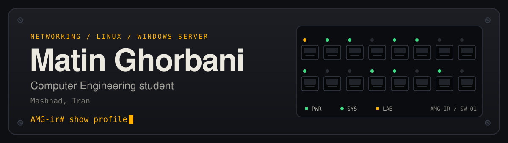
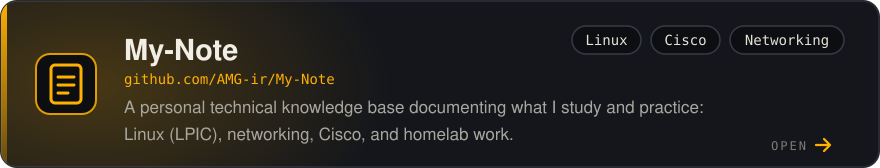
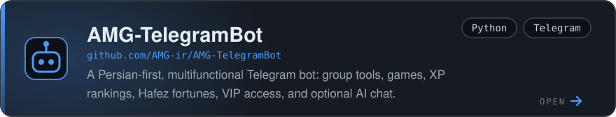
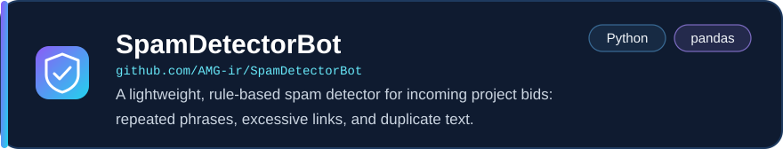
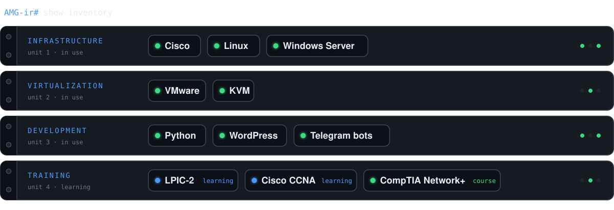

<div align="center">



<br>

[](https://matin-ghorbani.hashnode.dev)
[](https://linkedin.com/in/matin-ghorbani-ir)
[](https://t.me/AMGM_ru)

</div>


## 👋 About Me

I'm a Computer Engineering student building my skills in **networking, Linux & Windows administration, virtualization, and cybersecurity** through hands-on labs and personal projects.

```text
~$ cat about.txt
role     : Computer Engineering student, Islamic Azad University
location : Mashhad, Iran
focus    : Networking → Linux → Windows Server → Virtualization → Cybersecurity
learning : LPIC-2 · Cisco CCNA · CompTIA Network+
building : Telegram bots, automation scripts, WordPress sites
```


## 📌 Featured Projects

<a href="https://github.com/AMG-ir/My-Note"></a>

<a href="https://github.com/AMG-ir/AMG-TelegramBot"></a>

<a href="https://github.com/AMG-ir/SpamDetectorBot"></a>


## 🧰 Skills & Technologies




## 🔧 What I'm Working On

* 🐧 Linux system administration and troubleshooting
* 🌐 Networking fundamentals and Cisco technologies
* 🪟 Windows Server administration
* 🖥️ Virtualization with VMware and KVM
* 🐍 Python scripting and automation
* 🔐 Learning system and network security
* 🤖 Building small automation tools and Telegram bots
* 🌐 WordPress development and deployment

## 🎓 Education

**B.Sc. in Computer Engineering** (in progress)  
Islamic Azad University

<div align="center">

<sub>Building knowledge through courses, labs, personal projects, and hands-on experimentation.</sub>

</div>
